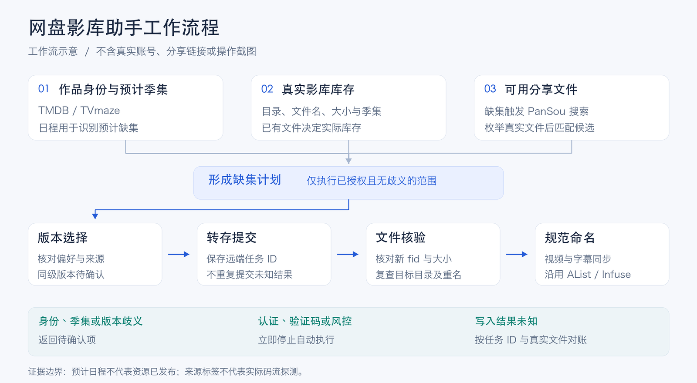

# 网盘影库助手

基于对话指令的影库管理工具。核对作品身份、预计季集与网盘库存，搜索缺失资源，在授权范围内完成夸克转存、文件核验和规范命名。通过命令行执行，播放端沿用现有 AList / Infuse。

## 工作流程



流程图为功能示意。预计日程、搜索线索和真实文件分别核验；出现作品、季集或版本歧义时返回待确认项。

| 能力 | 范围 |
| --- | --- |
| 作品匹配 | TMDB / TVmaze 身份、年份、别名及公共 ID 核对；电影使用 TMDB |
| 缺集转存 | 读取真实库存，仅补明确缺集；PanSou 搜索后实际枚举分享文件 |
| 统一命名 | 复用作品目录名前缀，按来源标签补充分辨率、动态范围与音轨，字幕同步 |
| 持续追更 | 按作品和季订阅，复用已确认来源，支持暂停、阻断与恢复 |
| 影库维护 | 只读体检、版本策略、新网盘建库、旧资源整理及单包隔离云解压 |
| 执行恢复 | 持久化任务 ID 和操作意图，按真实文件 ID 对账，避免重复提交 |

当前存储适配器支持夸克。其他网盘需新增 Provider；特殊季集、同级版本和覆盖冲突不自动处理。真实验收与尚未验证的边界见[验证报告](docs/test-report.md)。

## 首次配置

运行环境为 Python 3.11+，以及可用的 Apple Container（macOS）、Docker 或 Podman。引用 AList 凭据还要求当前 Python 的 SQLite 构建支持 `sqlite3.Connection.deserialize`；程序会在读取前检测此能力。Python 模块仅依赖标准库；容器运行时用于 PanSou 搜索服务。

1. 从 [config/headless.example.json](config/headless.example.json) 创建本地 `config/headless.json`；已有配置应保留。填写真实影库根目录及分类目录 ID，目录 ID 与 AList 展示路径不能混用。`archive_cleanup` 决定解压后原压缩包及清空的暂存目录保留（`keep`）、移入回收站（`recycle`）或每次询问（`ask`），见[压缩包检查与隔离解压](docs/media-maintenance.md#压缩包检查与隔离解压)。
2. 配置夸克凭据。使用私有 Cookie 文件时执行 `configure-quark`；引用已有 AList 挂载时改用 `configure-alist --storage-id N`，两种方式择一。
3. 使用电影功能或 TMDB 元数据时配置 TMDB 令牌，然后启动搜索服务并执行只读自检。

```bash
# 录入夸克 Cookie，保存为私有凭据文件，并将默认影库切换为文件凭据来源
python3 scripts/media.py configure-quark

# 录入 TMDB API 读取令牌，用于电影身份匹配及 TMDB 作品、季集与日程查询
python3 scripts/media.py configure-tmdb

# 启动 PanSou 网盘搜索服务；不执行转存，也不创建追更调度
python3 scripts/manage.py up

# 检查本地配置与搜索服务，并只读列出影库根目录，验证夸克访问权限
python3 scripts/media.py doctor --check-quark
```

凭据由终端隐藏输入，不接受明文命令行参数。AList 引用仅适用于本机 Apple Container 中的已有挂载；其他部署可使用私有凭据文件。文件权限、环境变量、容器平台及部署要求见[密钥存储与配置](docs/credentials.md)。

`manage.py` 仅管理本项目的 PanSou 服务，默认监听 `127.0.0.1:8888`。服务状态与停止命令为 `python3 scripts/manage.py status`、`python3 scripts/manage.py stop`；不修改或重启 AList / Infuse，也不创建定时调度。

## 常用命令

统一入口为 `scripts/media.py`。以下名称、年份和标识符均为示例，执行时应替换为目标作品及实际任务 ID。

```bash
# 只读查询与计划
python3 scripts/media.py request '查询《示例剧》，仅生成计划' --plan
python3 scripts/media.py request '查询电影《示例电影》 2025，仅生成计划' --plan

# 已获授权的转存请求
python3 scripts/media.py request '转存《示例剧》缺失集并规范命名'

# 查看、确认与恢复同一任务
python3 scripts/media.py status TASK_ID
python3 scripts/media.py confirm TASK_ID --quality 2160p --apply
python3 scripts/media.py reconcile TASK_ID
python3 scripts/media.py resume TASK_ID --apply
python3 scripts/media.py normalize-saved TASK_ID
# 跨日重新检查：生成新的只读计划，重新确认候选后再执行
python3 scripts/media.py replan TASK_ID
# 旧根目录范围日志阻断时：只读核对其已存文件，确认后加 --apply 迁入当前连接（仅写本地日志）
python3 scripts/media.py adopt-scope JOB_KEY
```

| 命令类型 | 执行规则 |
| --- | --- |
| `request` / `library request` | 根据请求文本判断是否执行；明确转存请求可写入，否定写入、预览或 `--plan` 保持只读 |
| `sync`、转存、解压、整理及 `watch run` | 云盘写入要求 `--apply`；支持 `--plan` 的命令中，`--plan` 优先 |
| `confirm` / `resume` / `normalize-saved` | 省略 `--apply` 时只读；这些命令不接受 `--plan` |
| `status` / `reconcile` / `replan` / 体检与计划 | 不写云盘；允许保存本地任务、计划或报告 |
| `adopt-scope` | 只读核对旧范围记录；`--apply` 仅写本地任务日志，不写云盘 |

确认与恢复均复用正式任务。`confirm` 仅接受已枚举候选；纯数字集号须有明确映射，不能按排序推断。详细身份、来源和恢复规则见[执行约定](docs/headless-design.md)。

## 命名示例


图片使用虚构作品说明规则，不是云盘操作截图。文件名优先于最近父目录的标签；缺失或冲突字段省略。只有显式 SDR 标签才输出 `SDR`，当前不下载视频或探测码流。完整格式、音轨与字幕规则见[命名与媒体信息](docs/headless-design.md#命名与媒体信息)。

新格式用于之后生成的计划，不批量迁移现有文件或旧任务日志。默认保留旧资源；旧文件整理须执行已获授权的保存计划，不覆盖目标文件。明确授权替换指定剧集并使用 `--remove-replaced` 时，新版本核验完成后才将记录中的旧文件移入回收站。

## 扩展操作

| 场景 | 入口与文档 |
| --- | --- |
| 新网盘接入、建库、扫描与导入 | `library`；[建库与导入说明](docs/library-bootstrap.md) |
| 精确匹配、体检与版本策略 | `match` / `health` / `policy`；[影库维护说明](docs/media-maintenance.md) |
| 压缩包转存、隔离解压与入库 | `archive`；[压缩包流程](docs/media-maintenance.md#从搜索结果转存压缩包并入库) |
| 单个作品目录原地改名 | `tidy`；[原地规范命名](docs/media-maintenance.md#单个作品目录原地规范命名) |
| 订阅与周期检查 | `watch`；[订阅执行约定](docs/headless-design.md#订阅与周期检查) |

建库仅创建目录，不自动整理旧资源、切换默认影库或创建订阅。生产影库支持电影与电视剧请求；新影库的追更尚未接入。持续追更由 `watch` 保存订阅、Codex heartbeat 周期唤醒，仅执行启用且已获授权的作品和季，阻断状态不会自动清除。

## 验证与文档

```bash
# 本地模拟测试，不操作真实云盘
PYTHONPATH=src python3 -m unittest discover -s tests

# 搜索服务已启动时的只读检查
python3 scripts/smoke.py
```

模拟测试与真实执行验收分别记录；服务、凭据和订阅的当前状态以实际检查为准。

- [执行约定](docs/headless-design.md)：模块、授权范围、命名与恢复规则。
- [季集更新来源](docs/metadata-assessment.md)：元数据关联、预计日程与库存的区别。
- [验证报告](docs/test-report.md)：真实验收、模拟覆盖及未验证限制。
- [历史记录](docs/archive/)：旧网页方案的验证资料，不作为当前功能验收。

## 参考项目与资料

设计与接口行为参考以下项目；执行器在 `src/media_helper/` 中独立实现，未导入其源码。

- [PanSou](https://github.com/fish2018/pansou)：网盘搜索服务。
- [Quark Auto Save X](https://github.com/x1ao4/quark-auto-save-x) 及其上游 [quark-auto-save](https://github.com/Cp0204/quark-auto-save)：夸克分享、转存、任务及云解压接口参考。
- [AList](https://github.com/AlistGo/alist)：夸克驱动文件移动接口与已有挂载凭据引用。
- [TMDB](https://developer.themoviedb.org/) / [TVmaze](https://www.tvmaze.com/api)：作品身份、别名、外部 ID 与季集日程。
- [Infuse Metadata 101](https://support.firecore.com/hc/en-us/articles/215090947-Metadata-101)：影视目录及文件命名参考。

上述项目与服务分别遵循其许可证及使用条款。

## 使用声明与许可证

本项目用于个人学习、研究和自有网盘整理，不提供、存储或分发影视资源。搜索结果来自第三方，仅应处理有权获取的内容；本项目与网盘、元数据及播放器服务方无关联，也未获其认可。

网盘非公开接口可能变更或触发服务限制。凭据应保存在私有目录，不得提交至 Git。软件按“原样”提供，不作任何担保；许可证及责任条款见 [MIT License](LICENSE)。
